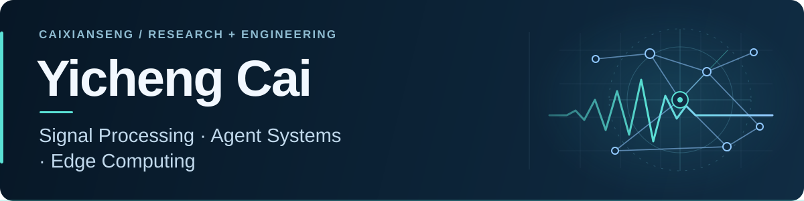

**物理建模与信号处理 · Agent 系统 · 可复现的工程实践**

北京交通大学 · 通信工程硕士在读

[精选项目](#selected-projects) · [技术能力](#toolbox) · [交流与合作](#connect)

## 关于我

我喜欢把问题拆成可建模、可实现、可验证的步骤。目前主要研究 **FMCW 雷达互干扰与恢复方法选择**，也在开发 **多 Agent 协作工具和记忆权限迁移原型**。

- **研究实践**：从物理接收链、观测特征到模型选择，关注方法的适用条件和评价依据。
- **工程实践**：使用 Python、C++ 和 Node.js 实现算法与工具，保留运行记录、复现入口与失败证据。
- **正在探索**：嵌入式与边缘系统、机器人与具身智能，以及 Agent 在研究和开发中的协作方式。

## 精选项目

### 01 / FMCW Radar Method Selector

**依据当前观测，为信号恢复选择合适的方法。**

构建四车道 FMCW 雷达互干扰仿真接收链，从受干扰 ADC 提取 **32 维观测特征**，用 MLP 预测候选方法的恢复代价，在 **MP、C-AR、JSS** 之间选择并执行恢复。

`物理接收链 → 观测特征 → 方法选择 → 复数 ADC 恢复 → 评价报告`

- 提供保存的仿真 ADC 示例、可移植冻结模型，以及包含波形、时频图和距离谱的 HTML 报告。
- **项目阶段**：仿真研究；评价结果对应仿真条件，当前不作实车检测率或实时处理承诺。

Python · NumPy · SciPy · scikit-learn · Signal Processing

**[查看仓库 →](https://github.com/Caixianseng/fmcw-radar-method-selector)** · [复现说明](https://github.com/Caixianseng/fmcw-radar-method-selector/blob/main/docs/reproduction.md)

---

### 02 / ESP32 × Linux Edge Scheduler

**合作开发 · 合成数据驱动的端侧上传与边缘任务调度。**

参与 ESP32 / ESP-IDF 与 Linux C11 边缘处理链的合作开发，采用 **TCP / NDJSON、有界队列与单工作线程**，实现 **FIFO / 非抢占优先级策略**、滤波及 RMS 计算，并保留逐任务运行日志。

- **工程验证**：完成 ESP32 固件构建、15 项真实 C 服务集成测试及 ASan / UBSan 检查；使用相同合成负载开展两种策略的重复对照。
- **项目阶段**：应用层非抢占任务调度；真实接板、无线链路与断线恢复待验证。

C11 · ESP32 / ESP-IDF · Linux / POSIX · TCP · Python

**[查看我的 Fork →](https://github.com/Caixianseng/esp32-linux-edge-scheduler)** · [合作原仓库](https://github.com/BJTURylynn/esp32-linux-edge-scheduler) · [验证记录](https://github.com/Caixianseng/esp32-linux-edge-scheduler/blob/main/docs/validation.md)

---

### 03 / Lianxu Agent Workbench

**把多模型协作组织成有依赖、有审查、有记录的任务流程。**

本地中文多 Agent 工作台，连接兼容 OpenAI 格式的模型 API 与本机 CLI，支持任务拆解、人工确认模型分工、执行审查、有限纠错与报告导出。

- 设置调用预算、依赖检查和失败分支停止机制；提供无需账号的演示模式。
- **项目阶段**：可运行的第一版；当前产出文本、分析与代码方案，自动修改项目、运行测试及合并代码尚未实现。

JavaScript · Node.js · API / CLI Integration · Agent Orchestration

**[查看仓库 →](https://github.com/Caixianseng/lianxu-agent-workbench)** · [启动与体验](https://github.com/Caixianseng/lianxu-agent-workbench#启动)

---

### 04 / Memory Migration Permission Pilot

**记忆迁移之后，谁还能读、能否转交、如何撤权？**

研究 Agent 与记忆后端之间的权限保持，使用来源校验、访问约束、假名化和本地恢复前核权，探索让合法用户继续完成任务的迁移流程。

- 提供迁移与隐私使用示例、工程回归，以及 Windows / Ubuntu 自动测试配置。
- **项目阶段**：研究原型；工程回归与模型效果分别评价，通用检测和算法收益仍需验证。

Python · Access Control · Pseudonymization · Evaluation

**[查看仓库 →](https://github.com/Caixianseng/memory-migration-permission-pilot)** · [流程、证据与研究边界](https://github.com/Caixianseng/memory-migration-permission-pilot#已验证成果与范围)

## 技术能力

| 方向 | 使用的技术与实践 |
| :--- | :--- |
| 编程与数值计算 | Python、C++、NumPy、SciPy、MATLAB |
| 信号处理与建模 | FMCW 接收链、时频分析、复数信号恢复、scikit-learn / MLP |
| Agent 与工具开发 | Node.js、模型 API、CLI 适配、任务依赖、审查与有限重试 |
| 工程验证 | Git、离线回归、跨平台 CI、日志取证、实验与复现文档 |
| 嵌入式合作实践 | ESP32 / ESP-IDF、Linux C / POSIX、TCP 数据链路与应用层任务队列 |

## 交流与合作

欢迎交流 **雷达信号处理、感知算法、Agent 工具与边缘计算、机器人开发**方向的实习机会。

可以从上面的项目仓库发起 Issue，讨论复现、问题或合作想法。

**[浏览我的 GitHub 仓库 →](https://github.com/Caixianseng?tab=repositories)**

从模型到代码，从运行结果到可核查的证据。

